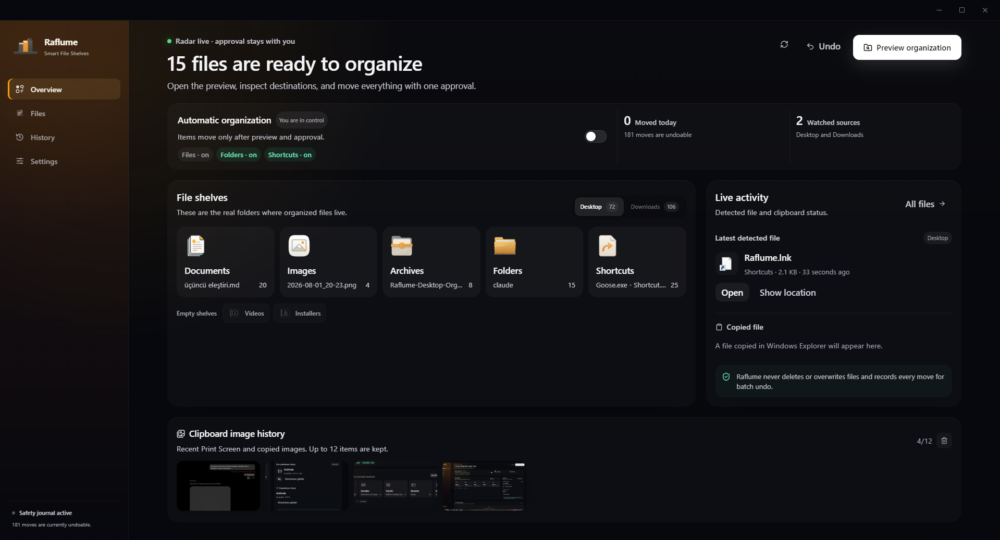
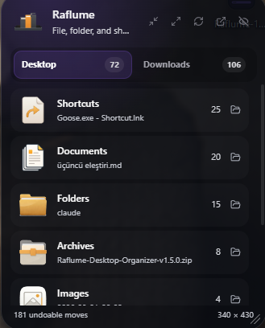

<div align="center">
  

# Raflume

**A safe, undoable Desktop and Downloads organizer for Windows.**

[Türkçe](README.md) · [English](README.en.md) · [Download the latest release](https://github.com/metopiw/raflume/releases/latest)


</div>

Raflume organizes your Desktop and Downloads without deleting files or overwriting existing items. Manual mode previews every destination and waits for your approval, while the movement journal lets you undo the entire latest batch.



## Highlights

- Separate shelves for documents, images, videos, installers, archives, folders, and shortcuts
- Manual preview and explicit user approval
- Optional automatic organization with startup scanning for existing items
- Collision-safe naming with no overwrites
- Persistent movement journal and batch undo
- Desktop, Downloads, and Windows Public Desktop support
- System tray, global shortcut, and a native desktop-layer widget that stays visible with Win+D
- Direct access to each shelf's latest item from the widget
- On-device clipboard image history limited to the latest 12 images
- Turkish and English interface

### Desktop widget



## Download and install

Download packages from [GitHub Releases](https://github.com/metopiw/raflume/releases/latest):

- **Setup EXE:** Recommended for a standard Windows installation.
- **Portable folder ZIP:** Extract the complete archive and run the root `Raflume.exe`. Keep that executable next to its `app` directory.

The distributed packages target Windows x64.

> [!WARNING]
> The current packages are not signed with a code-signing certificate, so Windows SmartScreen may display a warning. Download only from this repository's official Releases page and verify the file against the SHA-256 checksums attached to the Release.

Example verification in PowerShell:

```powershell
Get-FileHash .\Raflume-Setup-1.6.5-x64.exe -Algorithm SHA256
```

## Safety model

- Raflume never deletes files or directories.
- It never overwrites an occupied destination; it generates a collision-free name.
- Temporary downloads and protected Windows system files stay in place.
- Manual organization cannot start without preview and approval.
- Movements are journaled as `pending`, `completed`, `undone`, or `failed`.
- The renderer has no direct Node.js access (`contextIsolation: true`, `nodeIntegration: false`, `sandbox: true`).
- Clipboard images are never uploaded and remain in local user data.

Read [SECURITY.md](SECURITY.md) to report a vulnerability.

## Run from source

Requirements: Node.js 20+ and Windows.

```bash
npm ci
npm run dev
```

The root `Raflume.exe` is a small taskbar launcher that starts the source build without showing a console window. Rebuild it with `npm run build:launcher`.

Quality checks:

```bash
npm run typecheck
npm test
npm run build
```

Core stack: Electron 31, React 18, TypeScript 5.5, Vite 5, and Tailwind CSS 3.

## Contributing

Please read [CONTRIBUTING.md](CONTRIBUTING.md) before opening an issue or submitting a change. Behavioral changes must preserve the project's file-safety guarantees.

## License

[MIT License](LICENSE) © mertpivvo
